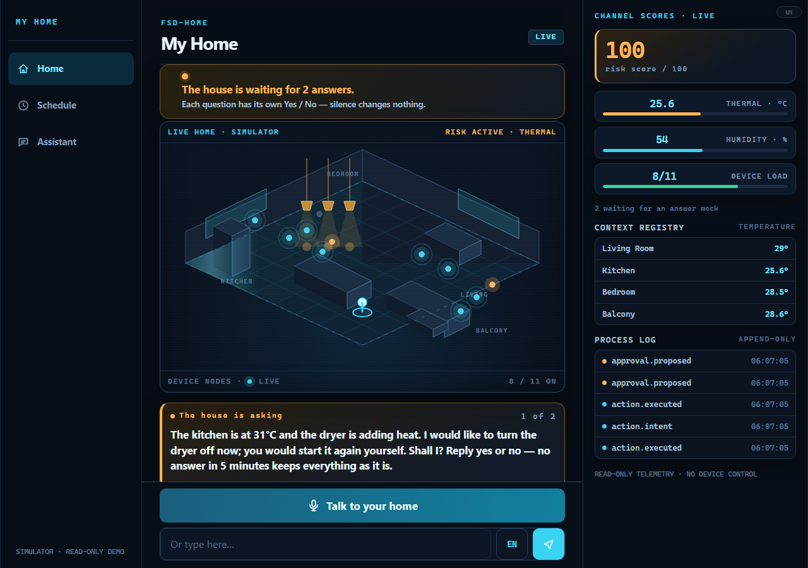
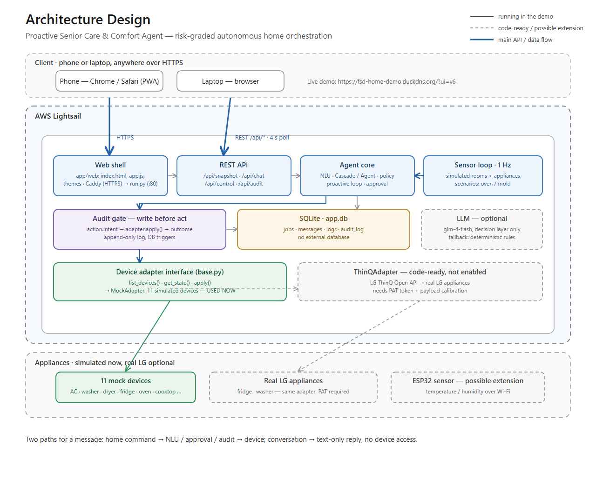

# FSD Home: Autonomous Energy Management Agent

> **New direction (after the 25 Nov 2026 review).** The project is now focused
> on energy: the user sets a monthly kWh budget and the Agent controls
> appliances within it — delaying the washer to the cheap band, optimising the
> AC setpoint, and blocking requests that would exceed the budget. Strict Mode
> ships enabled in this demo. Start at `/energy` for the dashboard and see
> [`docs/FSD-ENERGY.md`](docs/FSD-ENERGY.md) for the decision chain, the actual
> LLM prompt and the three presentation scenarios. The risk-graded senior-care
> behaviour below is retained as the underlying safety layer.

**Risk-graded autonomous home orchestration for safer, more comfortable living.**

A house that watches itself: a once-a-second loop over simulated sensors scores
four risk indices, then acts under a two-level safety policy. Low-stakes,
reversible actions run on their own. Anything that changes what the user planned
waits for an explicit answer, with a deadline.


## Live demo

Open the current simulator-based cloud demo: https://fsd-home-demo.duckdns.org/?ui=v6

- `/energy` is the new Energy Dashboard: budget, Strict Mode, decision log and the actual prompt.
- `/?ui=v6` (default) is the Mission Console live view; `?ui=v0`–`v5` switch the other overlays.
- `/soft/` is the interface built from the Figma design: four risk rings, the ask sheet, the
  savings card, and a language (6) and region (13) picker.
- The Phase 2 specification is in [`docs/project_specifications_final.pdf`](docs/project_specifications_final.pdf).

### Added after the Phase 2 specification

- **Two more risk indices:** HSI (heat stress, how hot the room feels to the person) and PLI
  (household power load at the peak rate). Like MRI and TOI they score 0–100 and act at 50.
- **Savings report (FR-7):** `GET /api/savings` estimates kWh saved, kWh moved off the peak,
  money and CO₂, only from actions the audit trail records as executed (`app/savings.py`).
- **Regions and languages:** `GET /api/regions` — Korea, the US average and six states, the UK,
  Germany, France, Spain and Italy, each with its tariff, time-of-use pair and grid emission factor
  and a source (`app/regions.py`); the `/soft/` interface speaks Korean, English, German, French,
  Spanish and Italian.



---

## Phase 2 core behaviour

The loop is `sensors at 1 Hz → risk evaluation → safety policy → act or ask`.
Two deterministic indices, both scored 0–100 and both triggering at 50.0:

- **MRI (Mold Risk Index)** — humidity trapped in a sealed washer drum, scored
  from drum humidity, how long it has been sealed, room temperature and the
  recent humidity trend.
- **TOI (Thermal Overload Index)** — kitchen heat load, scored from appliance
  wattage, kitchen temperature, refrigerator compressor duty cycle and a
  cooking session scheduled within the next 30 minutes.

**Level 1** runs automatically and is logged and reported. Every **Level 2**
action is presented as its own approval request; only an explicit confirmation
of that request executes that action.
An optional language model may rank Level 1 candidates, but it cannot add an
action outside the whitelist, approve a Level 2 action, or replace the rules —
if the model is unavailable or returns unusable output, the rules decide.

### Action whitelist (7 actions)

| Level | Action | Device |
|---|---|---|
| 1 | `ventilate_washer` | Washer drum vent |
| 1 | `dehumidifier_on` | Balcony dehumidifier |
| 1 | `purifier_on` | Living-room purifier |
| 1 | `ventilate_kitchen` | Kitchen range hood |
| 1 | `precool_kitchen` | Kitchen air conditioner |
| 2 | `stop_dryer` | Dryer |
| 2 | `preheat_cooktop` | Cooktop |

Each Level 2 action gets its **own approval request** — its own
`approval_id`, question, Yes / No buttons and deadline. Approving one can never
authorise another. Requests expire after **300 s**; declining one, or letting
it expire, leaves that appliance unchanged and starts a **30-minute** quiet
period for that risk.

Before a confirmed action reaches a device, the engine re-checks the approval,
the live risk, the device state and the safety interlocks against a fresh
sensor snapshot. If they no longer hold, the action is refused with a visible
reason and an `action.blocked` row. Preheating the cooktop is checked against
the meal rather than the risk score (stopping the dryer usually clears the
thermal index on its own): it needs `user_home` and a cooking session still
scheduled within 30 minutes, and it switches itself off if no cooking starts
after the scheduled time or its maximum run time is reached. Stopping the dryer leaves it off: once the risk clears, the
house sends one reminder and the user restarts it by hand — it is never
restarted automatically.

### Append-only safety log

`app/audit.py` is the single gate for every device change. The intent is
written **before** the adapter is called and the outcome immediately after;
if the intent cannot be persisted, nothing moves. `app/db.py` protects
`audit_log` with `BEFORE UPDATE` / `BEFORE DELETE` triggers, so rows cannot be
rewritten or removed by application code. `GET /api/audit` and the on-screen
Safety log show the same rows, linked by `approval_id`.


---

## Architecture



```text
Simulated sensors (1 Hz)
        |
        v
MRI / TOI risk evaluation         app/risk.py
        |
        v
Safety policy + action whitelist  app/policy.py
        |
        +--> Level 1: execute, log, report
        |
        +--> Level 2: ask -> revalidate -> confirm or expire   app/approval.py
        |
        v
Append-only audit_log: intent -> adapter -> outcome       app/audit.py
        |
        v
SQLite messages / logs + web status
```

| Directory | File | Module / responsibility |
|---|---|---|
| `app/` | `sensors.py` | 1 Hz simulated environmental and appliance telemetry |
| `app/` | `risk.py` | MRI and TOI evaluation |
| `app/` | `policy.py` | Seven-action whitelist and the two action levels |
| `app/` | `approval.py` | Per-action pending, confirmed, declined and expired requests |
| `app/` | `proactive.py` | Observe–decide–act loop, revalidation, safeguards, system messages |
| `app/` | `audit.py` | Write-before-act gate and append-only audit events |
| `app/` | `nlu.py` | Rule engine: time, device, action and status resolution |
| `app/` | `chat.py` | Text-only conversation layer (no tools, no device access) |
| `app/web/` | `index.html`, `app.js` | Approval queue, Safety log, device state, controls |
| `app/` | `db.py` | SQLite schedules, messages, immutable audit log |
| — | `run.py` | Entry point and demo scenarios |

---

## Quick start

For the current hosted simulator demo, open
<https://fsd-home-demo.duckdns.org/?ui=v6>.

To run a local development copy:

Python 3.10 or later. The core has **no third-party runtime dependencies**.

```bash
git clone https://github.com/tbrobo99/proactive-senior-care-comfort-agent.git
cd proactive-senior-care-comfort-agent
python run.py
```

On Windows, `start.bat` also runs the local development server.

---

## Two paths for a message

The Assistant page separates talking from acting:

```text
user message
├─ a home command -> rule engine -> whitelist / safety approval -> audited execute
└─ anything else  -> one short text reply (glm-4-flash, or local wording offline)
```

`app/chat.py` answers greetings, thank-yous, farewells and small talk. It is
given no tools, returns a string rather than an intent, and imports none of
the adapter, approval queue, scheduler or audit writer, so a conversational
reply cannot change a device. Home words (`AC`, `set`, `temperature`, `room`),
out-of-scope topics and the named scenes (`good morning`, `good night`,
`I'm leaving`) always stay on the command path. With the model off or
unreachable, short local wording answers instead, so `hello` still works in
the fully offline demo.

The rule engine no longer guesses a device. An appliance that is not in this
house (`TV`, `toaster`, ...) is named back to the user with a question rather
than silently writing to the device from the previous turn, while `set it to
22` still refers to that device. A temperature question in a room holding
several appliances goes to the air conditioner that reports the room
temperature, not to the first device in the list.

---

## Demo / use cases

### Use case 1 — mold risk

```bash
python run.py --scenario mold
```

MRI crosses its threshold; Level 1 actions such as washer ventilation and
dehumidification run automatically, and the interface explains what happened.

### Use case 2 — thermal overload

```bash
python run.py --scenario oven
```

TOI detects the upcoming cooking session and concurrent appliance load.
Level 1 cooling or ventilation runs automatically; the two Level 2 actions
appear as **two separate cards**, each with its own `approval_id`. Answering
one leaves the other pending. Because the first Yes can already clear the
risk, a second Yes may be refused by pre-execution revalidation — that is the
fail-safe working, and it is written to the safety log as `action.blocked`.
Declining, ignoring, or answering after the deadline never executes them.

Useful endpoints:

```bash
curl https://fsd-home-demo.duckdns.org/api/proactive
curl https://fsd-home-demo.duckdns.org/api/approvals
curl https://fsd-home-demo.duckdns.org/api/audit
curl https://fsd-home-demo.duckdns.org/api/logs
```

### Fully offline run (recommended for a recorded walkthrough)

Point the model at a dead port and the whole loop still completes on rules:

```bash
# macOS / Linux / Git Bash
LLM_BASE_URL=http://127.0.0.1:9 python run.py --no-browser --scenario oven
```

```powershell
# Windows PowerShell
$env:LLM_BASE_URL="http://127.0.0.1:9"; python run.py --no-browser --scenario oven
```

`/api/logs` then records `proactive.decide_fallback` — the model was
unreachable and the rules took the default — while the approval cards, Level 1
actions and confirmation all behave normally. Set `DATA_DIR` to keep the
database, device states and audit log out of the working tree; a fresh
directory starts from clean device defaults.

---

## Tests

```bash
python -m unittest discover -s tests -v
python -m eval.run
python -m eval.latency
```

`docs/TEST_PLAN.md` records the test cases with expected / actual / status,
based on commands actually run (364 tests OK, plus the intent regression).

The unit suite covers the risk indices, the seven-action whitelist, per-action
approvals, pre-execution revalidation, cooktop safeguards, the append-only
audit trail, the demo password gate, live notifications, optional preference
learning, and the command / conversation split (`tests/test_chat.py`
uses a scripted model to check that a chat request carries no tools and that
no device write or audit action follows a greeting). `eval.run` is the
intent-parser regression suite. `eval.latency`
measures the local check and the model-backed decision separately; **without
an LLM key only the local check half is measured**. GitHub Actions runs the
unit tests and `eval.run` on Windows and Linux with Python 3.10, 3.12 and 3.13.

---

## Options and scope

- **Optional LLM:** copy `config.example.json` to `config.json` and fill in the
  `llm` section. The `chat` section enables plain-text replies for greetings
  and small talk; `chat.enabled: false` uses short local wording instead. The
  model never owns sensor timing, risk calculation, approval or device safety.
- **Optional LG ThinQ adapter:** `app/devices/thinq.py`, with `dry_run` enabled
  by default. Real-device control needs the optional `thinqconnect` SDK and
  payload calibration per appliance model.
- **Demo password:** set `DEMO_PASSWORD` in the environment to require a
  password on a hosted copy. Local runs have no gate. A signed cookie keeps
  the session for 24 h; rotating the password signs everyone out.
- **Live notifications:** with `Enable alerts` the page shows browser
  notifications for Tier-2 approvals, automatic actions and the dryer
  reminder. They arrive over server-sent events while a page is open.
- **Preference learning:** off by default. When enabled it records repeated
  explicit answers so a future version could ask less often; it never skips a
  Tier-2 approval or changes the safety rules.
- **Scope:** simulated sensors and appliances for the course demonstration;
  local, single-user environment; voice input needs browser speech support,
  typing remains available.

---

## Team

| Name | Organization | Email |
| --- | --- | --- |
| Ha Yun Kim | Department of Information Systems, Hanyang University | hykim1215@hanyang.ac.kr |
| SooYoung Song | Department of Information Systems, Hanyang University | sys1109@hanyang.ac.kr |
| Ruitan Sun | Department of Information Systems, Hanyang University | sunruitan2024@126.com |
| Tang Bin | Department of Information Systems, Hanyang University | tbrobo99@outlook.com |

---

## Project documentation

- `docs/project_specifications_final.tex` — team's Phase 2 specification (IEEE LaTeX, milestone B)
- `docs/SPECIFICATION.md`, `docs/DECISION-ENGINE-SPEC.md` — technical specification
- `docs/tex/part-a.tex`, `docs/tex/part-b.tex` — earlier IEEE LaTeX drafts
- `docs/DEPLOY.md`, `docs/APP.md` — deployment and phone interface notes

MIT License.
