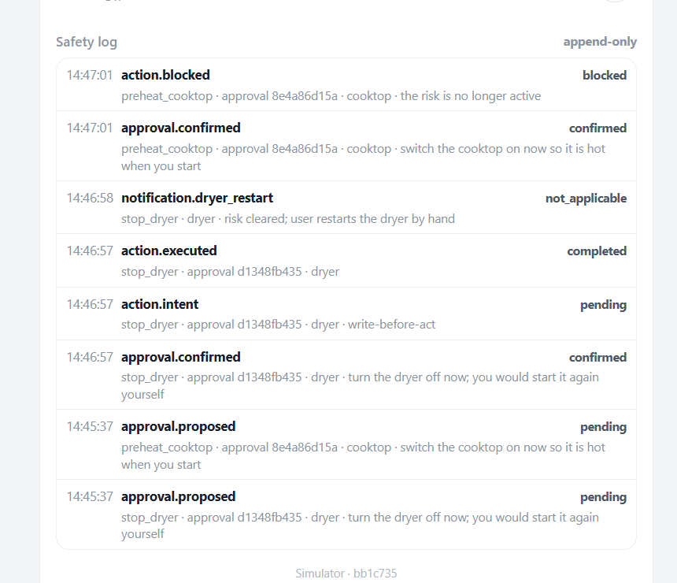

# FSD Home: Autonomous Energy Management Agent

**An autonomous smart home agent that manages energy consumption, controls devices, and makes decisions based on the user's energy budget.**

A house that watches itself: a once-a-second loop over simulated sensors scores
risk indices, then acts inside a monthly energy budget the user set in advance.
Setting the budget is the pre-authorisation — inside it the agent controls
devices on its own. The budget is a **hard limit by default**: a start or an
increase that does not fit is blocked, and the gate fails closed (a budget that
cannot be read is not a budget with room left). The one exception is an
explicit, audited manual override on the console — an emergency action, not
autonomous behaviour. Non-energy risks keep the original two-level approval
policy.


## Motivation & differentiation

Existing LG and Samsung apps already show energy information and allow schedules.
The contribution here is not another monitoring dashboard. It is one decision
layer that spans every control path: the proactive loop, chat commands, the raw
REST control endpoint and the scheduler all pass through the same
`budget.can_start()` gate before an action reaches a device.

| Ordinary energy monitoring | FSD Home agent |
|---|---|
| Shows how much was used | Decides what may start under a monthly kWh budget |
| Gives the user energy information | Converts budget, tariff and device state into ALLOW / BLOCK / DELAY |
| User starts devices and picks times | Agent defers movable loads to off-peak by itself |
| User controls each device manually | Agent acts autonomously inside pre-authorised limits |

The narrow claim is deliberate: the difference is the **closed-loop budget
governance and append-only decision trail**, not a claim that commercial systems
have no automation.

## Live demo

Open the current simulator-based cloud demo: https://fsd-home-demo.duckdns.org/?ui=v6

- `/?ui=v6` (default) is the Mission Console live view; `?ui=v0`–`v5` switch the other overlays.
- `/soft/` is the interface built from the Figma design: four risk rings, the ask sheet, the
  savings card, and a language (6) and region (13) picker.
- `/energy` is the Energy Dashboard: monthly kWh budget, cumulative use, estimated cost,
  instantaneous kW and the recent decisions with their source (LLM / rules fallback /
  rules override). Setting the budget there is the pre-authorisation act.
- The LLM path is deployed but currently off in the hosted config, so the live demo uses
  deterministic rules. The local Zhipu / `glm-4-flash` path has been tested directly.
- The Phase 2 specification is in [`docs/project_specifications_final.pdf`](docs/project_specifications_final.pdf).

### Added after the Phase 2 specification

- **Two more risk indices:** HSI (heat stress, how hot the room feels to the person) and PLI
  (household power load at the peak rate). Like MRI and TOI they score 0–100 and act at 50.
- **Savings report (FR-7):** `GET /api/savings` estimates kWh saved, kWh moved off the peak,
  money and CO₂, only from actions the audit trail records as executed (`app/savings.py`).
- **Energy budget (FR-8):** `GET/POST /api/budget` and `app/budget.py` integrate measured
  watts into cumulative kWh, enforce a monthly cap, and expose one `can_start()` gate used
  by the proactive loop, chat commands, the raw control API and the scheduler. A deferred
  start is queued in SQLite and re-checked when it runs. Decision provenance distinguishes
  a real LLM reply from a rules fallback and a rules override, and stores the actual
  prompt, input and output. All figures are simulator estimates, not meter readings.
- **Regions and languages:** `GET /api/regions` — Korea, the US average and six states, the UK,
  Germany, France, Spain and Italy, each with its tariff, time-of-use pair and grid emission factor
  and a source (`app/regions.py`); the `/soft/` interface speaks Korean, English, German, French,
  Spanish and Italian.


---

## Legacy / additional safety features

The original Phase 2 risk and approval behaviour is still active for
**non-energy safety risks**. Energy actions are different: setting the monthly
budget is the pre-authorisation, and `budget.gate()` returns ALLOW / BLOCK /
DELAY before execution. Energy actions do not create Tier-2 approval cards.

| Control policy | Energy actions | Non-energy safety actions |
|---|---|---|
| User authorisation | Setting the monthly budget | Per-action confirmation under the original safety policy |
| Execution | Autonomous inside the budget | May need a Tier-2 approval |
| Budget validation | Required on every path | Applied when the action starts or raises a load |
| Hard safety rules | Required: cooktop / oven / spent budget are blocked | Required |

The older loop is `sensors at 1 Hz → risk evaluation → safety policy → act or ask`.
Two deterministic indices, both scored 0–100 and both triggering at 50.0:

- **MRI (Mold Risk Index)** — humidity trapped in a sealed washer drum, scored
  from drum humidity, how long it has been sealed, room temperature and the
  recent humidity trend.
- **TOI (Thermal Overload Index)** — kitchen heat load, scored from appliance
  wattage, kitchen temperature, refrigerator compressor duty cycle and a
  cooking session scheduled within the next 30 minutes.

For these **non-energy** risks, **Level 1** runs automatically and is logged
and reported. Every **Level 2** action is presented as its own approval request;
only an explicit confirmation of that request executes that action.
An optional language model may rank Level 1 candidates, but it cannot add an
action outside the whitelist, approve a Level 2 action, or replace the rules —
if the model is unavailable or returns unusable output, the rules decide.

### Action whitelist (7 actions)

| Level | Action | Device |
|---|---|---|
| 1 | `ventilate_washer` | Washer drum vent |
| 1 | `dehumidifier_on` | Balcony dehumidifier |
| 1 | `purifier_on` | Living-room purifier |
| 1 | `ventilate_kitchen` | Kitchen range hood |
| 1 | `precool_kitchen` | Kitchen air conditioner |
| 2 | `stop_dryer` | Dryer |
| 2 | `preheat_cooktop` | Cooktop |

Each Level 2 action gets its **own approval request** — its own
`approval_id`, question, Yes / No buttons and deadline. Approving one can never
authorise another. Requests expire after **300 s**; declining one, or letting
it expire, leaves that appliance unchanged and starts a **30-minute** quiet
period for that risk.

Before a confirmed action reaches a device, the engine re-checks the approval,
the live risk, the device state and the safety interlocks against a fresh
sensor snapshot. If they no longer hold, the action is refused with a visible
reason and an `action.blocked` row. Preheating the cooktop is checked against
the meal rather than the risk score (stopping the dryer usually clears the
thermal index on its own): it needs `user_home` and a cooking session still
scheduled within 30 minutes, and it switches itself off if no cooking starts
after the scheduled time or its maximum run time is reached. Stopping the dryer leaves it off: once the risk clears, the
house sends one reminder and the user restarts it by hand — it is never
restarted automatically.

### Append-only safety log

`app/audit.py` is the single gate for every device change. The intent is
written **before** the adapter is called and the outcome immediately after;
if the intent cannot be persisted, nothing moves. `app/db.py` protects
`audit_log` with `BEFORE UPDATE` / `BEFORE DELETE` triggers, so rows cannot be
rewritten or removed by application code. `GET /api/audit` and the on-screen
Safety log show the same rows, linked by `approval_id`.



---

## Dataset & sensor data

All sensing in the course demo is **simulated**. `app/sensors.py` keeps room and
appliance state in memory, samples at **1 Hz**, and exposes one snapshot via
`/api/snapshot`. The UI polls REST every 4 s. The LLM is **not** called on every
sensor tick.

| Field | Unit | Source in code | Used for |
|---|---|---|---|
| `ts` | ISO timestamp | System clock in `sensors.snapshot()` | Risk history, logs and decision time |
| Room temperature | °C | Simulated `rooms` in `sensors.py` | MRI / TOI / comfort checks |
| Humidity | % | Simulated room and washer-drum values | Mold risk |
| Device state | ON/OFF, cycle, door, mode | Device adapter state + simulator `appliances` | Candidate generation; DELAY only if not yet running |
| Instantaneous draw | W | `total_load_w`, computed from simulated device draw | Power load index, live kW, `budget.accrue()` |
| Cumulative energy | kWh | `energy_state.used_kwh`, time integral of watts | Monthly budget check |
| Remaining budget | kWh | `budget_kwh - used_kwh` | ALLOW / BLOCK decision |
| Tariff and price | peak/offpeak, regional currency/kWh | `sensors.tariff` + `app/regions.py` | Move loads to off-peak; cost estimate |
| Decision provenance | source, reason, prompt, input, output | `energy_decisions`, append-only | Energy Dashboard and audit trail |

Nameplate watts in `sensors.py` use real LG model figures as simulation inputs.
They are **not** live meter readings. `budget.accrue()` computes
`kWh = watts × elapsed_seconds / 3,600,000`, so cumulative kWh is derived from
time, not from a tick count.

---

## Architecture


```text
1 · DATA INPUT — CONTINUOUS, LOCAL, NO LLM

Home data sources                 Sensor loop · 1 Hz                  Energy context
simulated device states            reads rooms + appliances            used / remaining kWh
optional ESP32 sensors            builds one snapshot                 tariff · budget · Strict Mode
power · temp · humidity           local polling — no model call       app/budget.py + SQLite
        | readings                        | snapshot
        +--------------------------------+-------------------------------+

2 · DECISION — EVENT-TRIGGERED

                         only when a command or risk event occurs
                                         |
Agent core  -- prompt + context -->  LLM — optional  -- validate -->  Deterministic rule validator
chat · proactive event          <-- JSON proposal --        checks budget.can_start() · safety · time
REST /api/control bypasses LLM       event-triggered         FINAL AUTHORITY · safe fallback
but still passes budget gate         cloud config off

3 · EXECUTION & FEEDBACK — CLOSED LOOP

Deterministic rule validator
        |
        v
Audit execution gate  ->  Device adapter  ->  Dashboard + decision log
write intent before       mock now           budget · reason · outcome · prompt
BLOCK stops here          LG ThinQ optional  /energy · append-only history
        ^                        |
        +---- state feedback: get_state(); read on next 1 Hz tick ----+
```

The LLM call is event-triggered, never part of the 1 Hz sensor tick. The hosted
demo has the LLM path deployed but currently off, so the rules and budget gate
complete the decision loop. The local Zhipu path has been tested directly.

**The gate fails closed.** If `budget.gate()` raises — SQLite locked, the energy
row unreadable, the module itself broken — the exception is not treated as
"budget is fine". Anything that starts a device or raises a load is refused and
written to `audit_log` as `budget.gate_failed`, while power-off and
load-reducing actions stay allowed: refusing to switch something off because
the budget is unreadable would be the more dangerous of the two failures.

## LLM decision engine & prompt engineering

`app/proactive.py:_decide()` is the decision point. It runs when a risk has
rule-generated candidates. The model may only choose from those candidates;
it cannot invent an action, approve a Tier-2 request, or touch a device. The
base prompt keeps its original senior-care wording because the requirement was
to extend the working decision engine, not discard it; FR-8 adds the energy
addendum below.

Real prompt, input and output are appended to `energy_decisions` by
`_trace_decision()` and shown in the Energy Dashboard through `/api/budget`.
`source` is one of `llm`, `rules_fallback`, `rules_override`, `rules`; only an
actual model reply counts as `llm`.

### System prompt — exact base text in `app/proactive.py`

```text
You are the decision layer of a proactive smart-home agent for a
household that includes a senior. Sensors have flagged a risk; rules have
proposed candidate actions. Your job is to choose.

Choose only from the candidates, and list them in the order they should run.
You may:
- take some and leave others (a candidate whose device is offline or already in
  the wanted state should be left alone),
- reorder them when the order matters,
- take none, if the evidence says the situation is resolving on its own.

You cannot execute anything yourself.

Answer with the kind names you chose, in order, as JSON only and nothing else:
{"chosen": ["candidate_kind", "..."]}

Use an empty list, {"chosen": []}, when the right answer is to do nothing.
```

### Energy addendum — appended only for `risk.kind == "energy"`

```text
ENERGY BUDGET (when the risk kind is "energy"):
The household pre-authorised autonomous energy control by setting a monthly
kWh budget. You still choose only from the listed candidates; you never invent
an action. For each candidate that would START or raise the load of a device:
  - ALLOW  — the estimated kWh fits the remaining budget.
  - BLOCK  — the estimate would exceed the remaining budget, or the device is
             outside autonomous authority (cooktop, oven).
  - DELAY  — the device is not running yet and is movable (washer, dryer,
             dishwasher) and the band is peak. Name the off-peak time.
  - OPTIMIZE — a reversible setpoint change saves energy without stopping a plan.
Never DELAY a device that is already running: a real appliance may not support
pause and resume. Return the same JSON shape, with each chosen entry as an
object: {"kind": "...", "verdict": "ALLOW|BLOCK|DELAY|OPTIMIZE",
"reason": "one short clause", "scheduled_at": "ISO time if DELAY"}.
A BLOCK verdict you return is honoured; it is never overridden into a start.
```

### Input context built by `_decide()`

```text
Risk: <risk headline>
Drivers: <risk drivers as JSON>
User home: <occupancy.boolean>

Budget: <used_kwh> of <budget_kwh> kWh used, <remaining_kwh> kWh left, strict=<bool>.
Tariff band: <peak|offpeak>; instantaneous draw: <kW> kW.

Candidates:
- kind=<candidate.kind> tier=<1|2> device=<name> does: <label> (why: <reason>)
```

### Output contract and validation

```json
{"chosen": [{"kind": "candidate_kind", "verdict": "ALLOW|BLOCK|DELAY|OPTIMIZE", "reason": "one short clause", "scheduled_at": "ISO time if DELAY"}]}
```

The validation chain is deliberately stricter than the model:

- unknown `kind` values are rejected and written to `audit_log` as `action.blocked`;
- a model `BLOCK` is never turned into a start;
- every start is still checked by `budget.can_start()`;
- an unreachable model, bad JSON or missing `chosen` key falls back to rules;
- the final source and the raw prompt/input/output are recorded, not inferred.

### Intent classification for the long tail

`app/classifier.py` is a second, deliberately smaller LLM use. When the rules
cannot read a message at all, one JSON round trip — no tools, no device ids,
no action schema — labels it `command`, `observation`, `smalltalk`,
`outside_weather` or `clarification`, with the room it names and a confidence.
A confident `command` is handed back to the cascade (tier 2 / tool loop), where
every write still passes the whitelist, the safety checks and the budget gate;
anything else only buys one clarification question or the honest weather reply,
never an action. A statement about temperature is not a command: "today is
cold" and "I am cold" ask a question or name the missing data, and a room that
IS named ("the bedroom is cold") is executed by the rules exactly as before.
With the LLM off, the cascade is unchanged — the rules answer all of these on
their own.

| Directory | File | Module / responsibility |
|---|---|---|
| `app/` | `sensors.py` | 1 Hz simulated room/appliance telemetry and tariff band |
| `app/` | `risk.py` | MRI, TOI, HSI and PLI risk indices |
| `app/` | `policy.py` | Action whitelist, energy candidates and two action levels |
| `app/` | `approval.py` | Tier-2 pending / confirmed / declined / expired requests |
| `app/` | `budget.py` | FR-8: kW/kWh/cost split, monthly budget, ALLOW/BLOCK/DELAY gate, provenance |
| `app/` | `scheduler.py` | SQLite-backed delayed jobs; re-checks budget at execution time |
| `app/` | `regions.py` | Regional price, currency, time-of-use band and CO₂ source |
| `app/` | `savings.py` | FR-7: estimates only from executed audit rows |
| `app/` | `proactive.py` | Observe–decide–act loop, real prompts, revalidation and safeguards |
| `app/` | `agent_loop.py`, `tools.py` | Tool-calling chat path; tool control also passes the budget gate |
| `app/` | `audit.py` | Write-before-act gate and append-only audit events |
| `app/` | `nlu.py`, `ko.py`, `chat.py` | Rule NLU, Korean input and text-only conversation layer |
| `app/` | `classifier.py` | No-tool intent classifier for messages the rules cannot read |
| `app/web/` | `index.html`, `app.js`, `energy.html` | Home / Schedule / Assistant / Energy tabs and Energy Dashboard |
| `app/` | `db.py` | SQLite schedules, messages, `audit_log`, `energy_state`, `energy_decisions` and triggers |
| — | `run.py` | Entry point and demo scenarios |

---

## Quick start

For the current hosted simulator demo, open
<https://fsd-home-demo.duckdns.org/?ui=v6>.

To run a local development copy:

Python 3.10 or later. The core has **no third-party runtime dependencies**.

```bash
git clone https://github.com/tbrobo99/proactive-senior-care-comfort-agent.git
cd proactive-senior-care-comfort-agent
python run.py
```

On Windows, `start.bat` also runs the local development server.

## API surface

| Endpoint | Purpose |
|---|---|
| `GET /api/snapshot` | Devices, jobs, tariff band, instantaneous load |
| `GET /api/budget` | Monthly kWh state, cost estimate and recent decision provenance |
| `POST /api/budget` | Set the monthly budget — the pre-authorisation act |
| `POST /api/chat` | Typed command / assistant path |
| `POST /api/control` | Direct device control; still passes `budget.gate()` (hard limit); `override` is the audited exception |
| `GET /api/proactive`, `GET /api/approvals` | Risk state and remaining non-energy Tier-2 requests |
| `GET /api/audit`, `GET /api/savings`, `GET /api/regions` | Append-only log, executed-action savings, regional tariffs |
| `GET /api/events` | Server-sent events for live status |

---

## Two paths for a message

The Assistant page separates talking from acting:

```text
user message
├─ a home command -> rule engine -> whitelist / safety -> budget gate -> audited execute
└─ anything else  -> one short text reply (glm-4-flash, or local wording offline)
```

`app/chat.py` answers greetings, thank-yous, farewells and small talk. It is
given no tools, returns a string rather than an intent, and imports none of
the adapter, approval queue, scheduler or audit writer, so a conversational
reply cannot change a device. Home words (`AC`, `set`, `temperature`, `room`),
out-of-scope topics and the named scenes (`good morning`, `good night`,
`I'm leaving`) always stay on the command path. With the model off or
unreachable, short local wording answers instead, so `hello` still works in
the fully offline demo.

The rule engine no longer guesses a device. An appliance that is not in this
house (`TV`, `toaster`, ...) is named back to the user with a question rather
than silently writing to the device from the previous turn, while `set it to
22` still refers to that device. A temperature question in a room holding
several appliances goes to the air conditioner that reports the room
temperature, not to the first device in the list.

---

## FSD demo scenarios

Start a clean peak-band demo:

```bash
python run.py --no-browser --port 8860 --scenario peak
```

### Scenario 1 — autonomous load scheduling (DELAY)

In the Assistant, type:

```text
turn on the washing machine
```

At peak price the agent does not start the washer. It creates a real scheduler
job for the next off-peak band (22:00 in the Korea preset), reports the reason,
and the scheduler re-checks the budget when the job becomes due.

```bash
curl http://127.0.0.1:8860/api/snapshot
curl http://127.0.0.1:8860/api/budget
```

### Scenario 2 — strict energy budget enforcement (BLOCK)

Set a tiny monthly budget, then try a raw control request. The direct API
bypasses the LLM but not the budget gate:

```bash
curl -X POST http://127.0.0.1:8860/api/budget \
  -H "Content-Type: application/json" \
  -d '{"budget_kwh":0.01,"strict_mode":true}'

curl -X POST http://127.0.0.1:8860/api/control \
  -H "Content-Type: application/json" \
  -d '{"device_id":"dryer","actions":[{"action":"power","value":true}]}'
```

The second request returns `403` with a reason naming the estimated kWh and the
remaining kWh. The budget is enforced by default on every path; the only
exception is `override: true`, an explicit emergency manual action that writes
its bypass and reason to the append-only audit log. It is not autonomous
behaviour, and it is not what the agent does on its own.

### Scenario 3 — autonomous energy optimization (OPTIMIZE)

With `--scenario peak`, the proactive loop sees a high household load and
creates the rule-generated `eco_ac` candidate. The agent may raise the coldest
AC setpoint by 2 °C up to 26 °C. `OPTIMIZE` is the model's verdict label; the
action still passes rules, safety and the budget gate before execution.

```bash
curl http://127.0.0.1:8860/api/audit
curl http://127.0.0.1:8860/api/savings
```

### Additional safety scenario 1 — mold risk

```bash
python run.py --scenario mold
```

MRI crosses its threshold; Level 1 actions such as washer ventilation and
dehumidification run automatically, and the interface explains what happened.

### Additional safety scenario 2 — thermal overload

```bash
python run.py --scenario oven
```

TOI detects the upcoming cooking session and concurrent appliance load.
Level 1 cooling or ventilation runs automatically; the two Level 2 actions
appear as **two separate cards**, each with its own `approval_id`. Answering
one leaves the other pending. Because the first Yes can already clear the
risk, a second Yes may be refused by pre-execution revalidation — that is the
fail-safe working, and it is written to the safety log as `action.blocked`.
Declining, ignoring, or answering after the deadline never executes them.

Useful endpoints:

```bash
curl https://fsd-home-demo.duckdns.org/api/proactive
curl https://fsd-home-demo.duckdns.org/api/approvals
curl https://fsd-home-demo.duckdns.org/api/audit
curl https://fsd-home-demo.duckdns.org/api/logs
```

### Fully offline run (recommended for a recorded walkthrough)

Point the model at a dead port and the whole loop still completes on rules:

```bash
# macOS / Linux / Git Bash
LLM_BASE_URL=http://127.0.0.1:9 python run.py --no-browser --scenario oven
```

```powershell
# Windows PowerShell
$env:LLM_BASE_URL="http://127.0.0.1:9"; python run.py --no-browser --scenario oven
```

`/api/logs` then records `proactive.decide_fallback` — the model was
unreachable and the rules took the default — while the approval cards, Level 1
actions and confirmation all behave normally. Set `DATA_DIR` to keep the
database, device states and audit log out of the working tree; a fresh
directory starts from clean device defaults.

---

## Tests

```bash
python -m unittest discover -s tests -v
python -m eval.run
python -m eval.latency
```

`docs/TEST_PLAN.md` records the historical test cases with expected / actual /
status. The current working tree was run with Python 3.11 on 2026-11-26:

```text
py -3.11 -m unittest discover -s tests
Ran 419 tests in 99.872s
OK
```

The unit suite covers the risk indices, the action whitelist, per-action
approvals, pre-execution revalidation, cooktop safeguards, the append-only
audit trail, the monthly kWh budget, kW/kWh/cost separation, DELAY/BLOCK
decisions, scheduler re-checks, the demo password gate, live notifications,
optional preference learning, and the command / conversation split
(`tests/test_chat.py` uses a scripted model to check that a chat request carries
no tools and that no device write or audit action follows a greeting).
`eval.run` is the
intent-parser regression suite. `eval.latency`
measures the local check and the model-backed decision separately; **without
an LLM key only the local check half is measured**. GitHub Actions runs the
unit tests and `eval.run` on Windows and Linux with Python 3.10, 3.12 and 3.13.

---

## Limitations and deployment options

The course demo boundary is explicit: simulated sensors and appliances, no real
meter feed, no LG ThinQ connection and no mobile app. These are boundaries of
the submitted demo, not missing steps in the FSD decision loop.

- **LLM — implemented, currently off on the cloud demo:** copy
  `config.example.json` to `config.json` and fill in the `llm` section. The
  local Zhipu `glm-4-flash` path was tested directly; the hosted demo currently
  uses the deterministic rules fallback. The `chat` section enables plain-text
  replies for greetings and small talk; `chat.enabled: false` uses short local
  wording. The model never owns sensor timing, risk calculation, approval or
  device safety.
- **Optional LG ThinQ adapter:** `app/devices/thinq.py`, with `dry_run` enabled
  by default. Real-device control needs the optional `thinqconnect` SDK and
  payload calibration per appliance model.
- **Demo password:** set `DEMO_PASSWORD` in the environment to require a
  password on a hosted copy. Local runs have no gate. A signed cookie keeps
  the session for 24 h; rotating the password signs everyone out.
- **Live notifications:** with `Enable alerts` the page shows browser
  notifications for Tier-2 approvals, automatic actions and the dryer
  reminder. They arrive over server-sent events while a page is open.
- **Preference learning:** off by default. When enabled it records repeated
  explicit answers so a future version could ask less often; it never skips a
  Tier-2 approval or changes the safety rules.
- **Scope:** simulated sensors and appliances for the course demonstration;
  local, single-user environment; voice input needs browser speech support,
  typing remains available.

---

## Team

| Name | Organization | Email |
| --- | --- | --- |
| Ha Yun Kim | Department of Information Systems, Hanyang University | hykim1215@hanyang.ac.kr |
| SooYoung Song | Department of Information Systems, Hanyang University | sys1109@hanyang.ac.kr |
| Ruitan Sun | Department of Information Systems, Hanyang University | sunruitan2024@126.com |
| Tang Bin | Department of Information Systems, Hanyang University | tbrobo99@outlook.com |

---

## Project documentation

- `docs/project_specifications_final.tex` — team's Phase 2 specification (IEEE LaTeX, milestone B)
- `docs/SPECIFICATION.md`, `docs/DECISION-ENGINE-SPEC.md` — technical specification
- `docs/tex/part-a.tex`, `docs/tex/part-b.tex` — earlier IEEE LaTeX drafts
- `docs/DEPLOY.md`, `docs/APP.md` — deployment and phone interface notes

MIT License.
