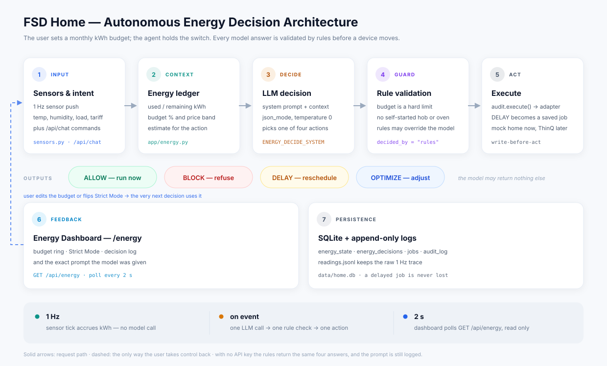

# FSD Home — Autonomous Energy Management Agent

**Technical note added after the 25 Nov 2026 project review.**
Owner: Tang Bin (decision engine / software).
Status: implemented in the local branch; **not pushed to GitHub**.

---

## 1. What changed, and why

The professor did not reject the existing agent. The criticism was that the
project was *too broad, too mild, and not differentiated*, and that the Agent's
decision process was not explicit. The new direction is:

> From *"the user controls appliances, AI advises"* to
> *"the user sets an energy goal, the Agent controls appliances"*.

| Professor's point | Implementation in this branch |
|---|---|
| Focus on energy management | `app/energy.py` becomes the decision engine; the old care/risk layers stay but are no longer the headline |
| Autonomous control, not advice | A user command in Strict Mode is answered with `DELAY` / `BLOCK` / `OPTIMIZE` before it reaches a device |
| Show how the LLM decides | `ENERGY_DECIDE_SYSTEM` prompt + structured JSON + decision log, all visible in `/energy` |
| Show the actual prompt | `/api/energy/prompt` and the dashboard's **Show actual prompt** button |
| Redraw the architecture | `docs/figures/fsd-energy-architecture.svg` |
| Energy budget, strictly enforced | Monthly kWh budget, `strict_mode`, invariant `estimated_kwh <= remaining_kwh` |
| Sensor source, input/output | 1 Hz sensor push, documented input JSON, one of four output actions |
| Push vs polling and frequency | Sensor push 1 Hz · dashboard HTTP polling 2 s · LLM only on energy events |
| Three demo scenarios | One-click buttons in the Energy Dashboard |
| Real LG ThinQ | Deliberately deferred; the mock adapter exercises the same code path |

The old two-tier safety policy is **not deleted**. It still governs mold,
thermal, heat-stress and non-strict energy events. The new energy layer sits
in front of it: a decision is made, rules validate it, and only then does the
existing audited `audit.execute()` path move a device.

---

## 2. The decision chain in five steps

```
1 SENSE    sensors snapshot @ 1 Hz  -> energy ledger integrates kWh
2 REQUEST  user command or fired energy risk -> one decision request (JSON)
3 DECIDE   LLM -> ALLOW | BLOCK | DELAY | OPTIMIZE + reason (JSON only)
4 VALIDATE rules override any answer that breaks budget / safety / comfort
5 ACT      audit.execute() or a durable scheduled job; decision written to log
```

### Algorithm / Input / Decision / Prompt / Output

These are the five questions asked in English during the meeting, answered
against the code:

| Question | Answer |
|---|---|
| *Which algorithm do you use?* | A deterministic energy estimator plus a rule validator. `estimated_kwh = nameplate_watts × typical_runtime / 1000`; `remaining_kwh = budget − used_kwh`. The LLM chooses among four actions; rules decide admissibility. |
| *How do you make a decision?* | Rules check hard constraints first: budget in Strict Mode, heating appliances, comfort band, and future delay time. The LLM's proposal is accepted only if it passes these checks. |
| *When do you make a recommendation?* | On an energy event: a user appliance request in Strict Mode, or the PLI risk crossing its threshold. Never on every sensor tick. |
| *What is your actual prompt?* | `ENERGY_DECIDE_SYSTEM` in `app/energy.py`, shown verbatim below and in the dashboard. |
| *How do you ask the LLM to make a decision?* | One system message with the prompt, one user message containing the decision context as JSON, `json_mode=True`, `temperature=0`, `max_tokens=300`, 8 s timeout. |

### Decision context (input, sent as the user message)

```json
{
  "device": "washer",
  "device_name": "Balcony Washer",
  "requested_actions": [{"action": "power", "value": true}],
  "source": "user",
  "current_load_w": 3100,
  "tariff": "peak",
  "price_krw_per_kwh": 180.0,
  "used_kwh": 8.0,
  "budget_kwh": 100.0,
  "remaining_kwh": 92.0,
  "estimated_kwh": 0.5,
  "user_home": true,
  "strict_mode": true
}
```

### Output (returned by the LLM, then validated)

```json
{
  "device": "washing_machine",
  "action": "DELAY",
  "reason": "High electricity price; run in the 22:00 cheap band",
  "scheduled_time": "2026-11-26T22:00",
  "actions": [{"action": "power", "value": true}],
  "estimated_kwh": 0.5
}
```

Example for `BLOCK`:

```json
{"device": "dryer", "action": "BLOCK",
 "reason": "Only 1 kWh left; the dryer needs 1.4 kWh",
 "scheduled_time": null, "actions": [], "estimated_kwh": 1.4}
```

---

## 3. Actual System Prompt (copy from `app/energy.py`)

```text
You are the decision engine of FSD Home, an autonomous home energy management agent.
The user has set a monthly energy budget and has authorised you to control their appliances within it.

Your primary goal is to minimise energy cost while respecting the user's energy budget,
safety constraints and comfort limits.

You will receive one JSON object with:
  device            - appliance id
  requested_actions - what the user or the risk layer asked for
  current_load_w    - whole-house draw right now
  tariff            - "peak" or "offpeak"
  price_krw_per_kwh - price in the current band
  used_kwh          - energy used this month so far
  budget_kwh        - the user's monthly limit
  remaining_kwh     - budget_kwh - used_kwh
  estimated_kwh     - energy the request would consume
  user_home         - whether somebody is home
  strict_mode       - whether the budget is enforced as a hard limit

Choose exactly ONE action:
  ALLOW    - run the appliance as requested
  BLOCK    - refuse to run it; the budget or safety would be violated
  DELAY    - run it later in a cheaper band; set scheduled_time (ISO, future)
  OPTIMIZE - run it with a cheaper setting; set actions to the modified list

Hard constraints (enforced in code after you answer, not by trust):
  1. In strict_mode, never ALLOW a request whose estimated_kwh exceeds remaining_kwh.
  2. Never switch an oven or cooktop ON yourself; those need an explicit user request.
  3. A DELAY time must be in the future and in the cheaper band.
  4. Keep air-conditioner cooling setpoints between 24 and 26 degrees Celsius.

Return ONLY this JSON and nothing else:
{"device":"...","action":"ALLOW|BLOCK|DELAY|OPTIMIZE","reason":"one short sentence","scheduled_time":null,"actions":[],"estimated_kwh":0.0}
```

The constraints are deliberately stated in the prompt *and* enforced in code.
The code is the authority: if the model returns `ALLOW` with 0.5 kWh remaining
and a request needing 1.4 kWh, the engine records `BLOCK`, sets
`overridden: true` and names `llm_proposed: ALLOW`. This is demonstrable in a
unit test (`test_rules_override_an_llm_allow_that_breaks_the_budget`).

No model key is required for the demo: when the LLM is unavailable, the same
rule chain produces the same four-way decision with `decided_by = "rules"`.
The prompt and the input context are still recorded.

---

## 4. Data flow: where data enters, how it travels, how often

| Question | Answer |
|---|---|
| Where do sensor readings enter? | `app/sensors.py` produces one snapshot per second; `ProactiveEngine.tick()` pushes it into `EnergyManager.accrue()`. |
| HTTP or something else? | Sensor → engine is an in-process call, not HTTP. Browser → server is HTTPS/HTTP REST plus server-sent events for notifications. |
| Push or polling? | **Sensors push** into the engine at 1 Hz. The **dashboard polls** `GET /api/energy` every 2 s. Devices are actuated through the adapter; nothing is polled from a real appliance in this build. |
| Sampling frequency | 1 Hz sensor tick, 2 s dashboard poll, 1 Hz scheduler scan for due jobs. |
| Where is data stored? | SQLite: `energy_state` (period, budget, used kWh, flags), `energy_decisions` (append-only decision log), existing `jobs`, `messages`, `audit_log`. Sensor traces: `data/sensors/readings.jsonl` + `latest.csv`. |
| When is the LLM called? | Only on an energy event, at most once per fired risk per 180 s cooldown. Never per tick. |
| How does a decision reach a device? | `ALLOW`/`OPTIMIZE` → `audit.execute()` (write-before-act). `DELAY` → durable one-time job in `jobs`, executed by `Scheduler`. `BLOCK` → `audit.blocked()`, nothing moves. |



---

## 5. Code map

| File | What was added |
|---|---|
| `app/energy.py` | `ENERGY_DECIDE_SYSTEM`, energy constants, `EnergyManager` (metering, estimate, decide, validate, apply, view) |
| `app/agent.py` | `_energy_gate()` intercepts appliance commands in Strict Mode; `ALLOW`/`OPTIMIZE` continue down the original path |
| `app/proactive.py` | Per-tick kWh accrual; `_energy_autonomous()` handles the energy risk without an approval question |
| `app/server.py` | `/api/energy`, `/api/energy/prompt`, `/api/energy/decide`, `/api/energy/demo`, `/api/energy/{strict,budget,llm,reset}` |
| `app/web/energy/` | Energy Dashboard: budget ring, Strict Mode switch, three demo buttons, decision log, actual prompt |
| `app/db.py` | `energy_state`, `energy_decisions` tables |
| `app/config.py`, `config.json` | `energy` section; demo config ships with `strict_mode: true` |
| `run.py` | One `EnergyManager` shared by chat and the sensor loop; startup banner |
| `tests/test_energy.py` | 15 tests covering metering, four decisions, LLM override, agent gate, autonomous loop |

---

## 6. Three presentation scenarios

Open `http://127.0.0.1:8848/energy` and press the buttons. Each button loads a
deterministic sensor state, makes one decision and writes it to the log.

### Scenario 1 — Automatic delay of the washing machine

*Setup:* peak tariff. User asks: *"turn on the washing machine"*.
*Agent:* `DELAY` → writes a one-time job for 22:00 and pauses the current wash.
*Shows:* LLM decision + automatic scheduling, no confirmation question.

### Scenario 2 — Automatic AC optimisation

*Setup:* peak tariff. User asks for 22 °C cooling.
*Agent:* `OPTIMIZE` → setpoint becomes 26 °C (comfort band), about 160 W less draw.
*Shows:* active control within a safety/comfort limit.

### Scenario 3 — Strict budget block

*Setup:* budget set to `used + 1 kWh`; dryer needs 1.4 kWh.
*Agent:* `BLOCK` → the dryer never starts, reason shown in the log.
*Shows:* Strict Mode and FSD autonomy with a hard budget.

The same three decisions can be produced through the chat box on the main
page (`/?ui=v6`), because the gate sits in `Agent.handle()`, not only in the
demo endpoint.

---

## 7. Run and verify

```bash
python run.py --no-browser --scenario peak
# open http://127.0.0.1:8848/energy

python -m unittest discover -s tests -q
```

The full suite covers the older care/risk behaviour and the new energy layer.
The original 364 tests were green before this change; the branch adds 15 more.

---

## 8. Limits, honestly stated

* LG ThinQ real-device control is **not** part of this change. The adapter interface is unchanged, so a real backend can be plugged in later.
* The tariff is a two-band simulation (180 / 90 KRW per kWh), not a live market feed.
* `estimated_kwh` uses nameplate watts × a typical runtime; it is a pre-action estimate, not a metered reading. Metered `used_kwh` integrates real simulated draw each tick.
* The model is called on events only. A provider outage does not stop the house: rules decide and the log records `decided_by = "rules"`.
* This branch was deliberately **not pushed** to GitHub; the changes are local.
