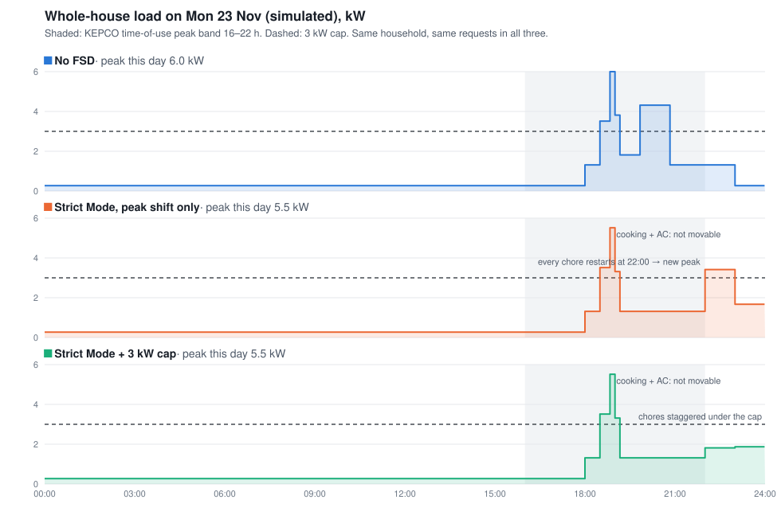

# Simulated week: before and after Strict Mode

Generated by `python -m eval.week`. One model household, seven days, one-minute steps (plus a quiet eighth day so late bookings can finish). Every FSD start goes through the real `budget.can_start()`. Cooking, lights, the fridge and cooling run the same in all three columns.

| | No FSD | Peak shift only | Peak shift + 3 kW cap | Cap vs no FSD |
|---|---:|---:|---:|---:|
| Highest load (kW) | 6.0 | 5.5 | 5.5 | -8% |
| Minutes over 3 kW | 490 | 570 | 210 | -57% |
| … of which cooking / cooling alone | 210 | 210 | 210 | +0% |
| Energy used (kWh) | 128.2 | 128.2 | 128.2 | +0% |
| kWh in the 16–22 h peak band | 75.0 | 52.4 | 52.4 | -30% |
| Cost, time-of-use (₩) | 23,916 | 22,068 | 22,068 | -8% |
| CO₂ (kg) | 53.5 | 53.5 | 53.5 | +0% |
| Chores done / not done | 19 / 0 | 19 / 0 | 19 / 0 | |
| Average / longest wait (min) | 0 / 0 | 104 / 220 | 142 / 220 | |

Shifting a load in time does not change kWh or CO₂ with one national grid factor, so those rows stay equal; the saving is in peak kW and time-of-use cost. Prices: KEPCO residential time-of-use (Jeju), peak 16–22 h.
